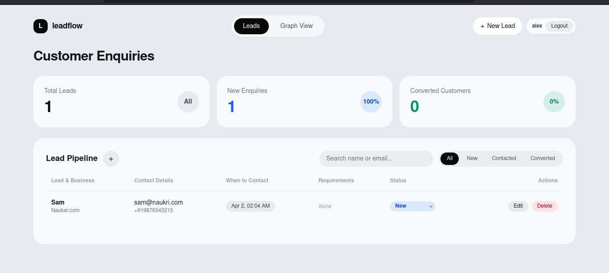
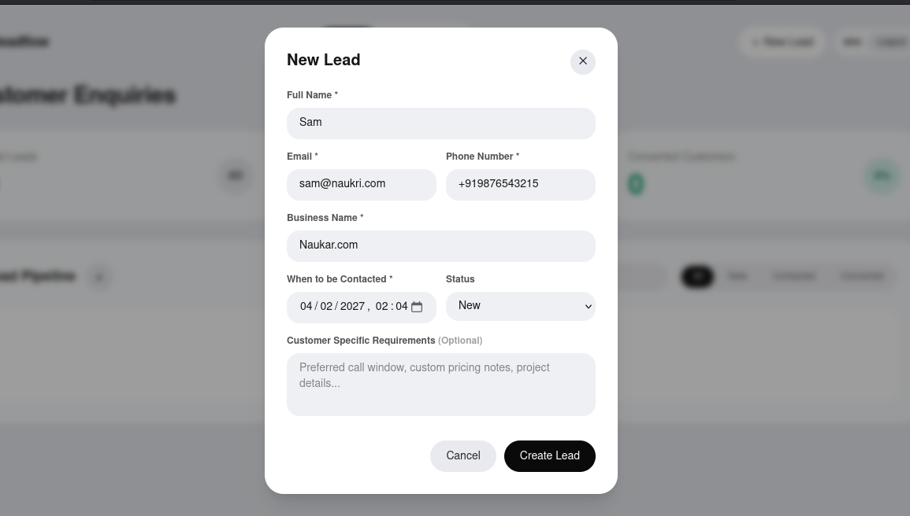
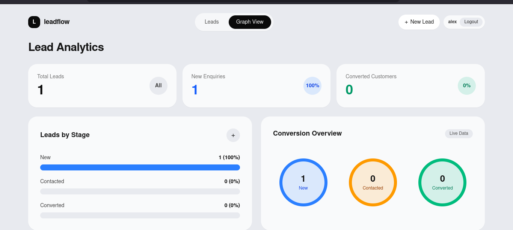

# LeadFlow — Customer Enquiry & Lead Management Dashboard

A full-stack CRM dashboard built with **React (Vite)**, **Tailwind CSS v4**, **Go (`net/http`)**, and **MongoDB** for tracking customer enquiries, scheduling follow-ups, and visualizing lead conversion metrics[cite: 2, 4].

---

## Interface & Visual Walkthrough

### 1. Customer Enquiries & Lead Pipeline (`Leads` View)


- **Top Navigation Bar:** Features the **leadflow** brand mark, centered pill switcher (**Leads** / **Graph View**), quick **+ New Lead** button, and active user session badge with **Logout**[cite: 4].
- **Dashboard Overview Cards:** Displays real-time totals and percentages for **Total Leads**, **New Enquiries**, and **Converted Customers**[cite: 4].
- **Lead Pipeline Table:** Search leads by name or email, filter by stage pills (**All**, **New**, **Contacted**, **Converted**), update status inline via dropdown, or click **Edit** / **Delete**[cite: 4].

---

### 2. Recording a New Enquiry (`+ New Lead` Modal)


- Captures **Full Name**, **Email**, **Phone Number**, **Business Name**, **When to be Contacted** (date/time scheduler), **Status** (`New`, `Contacted`, `Converted`), and optional **Customer Specific Requirements**[cite: 3].
- Performs both client-side and server-side validation before persisting records to MongoDB[cite: 3].

---

### 3. Lead Analytics (`Graph View`)


- **Leads by Stage:** Horizontal progress bars breaking down counts and percentages across **New**, **Contacted**, and **Converted** stages[cite: 2].
- **Conversion Overview:** Live circular ring indicators summarizing pipeline distribution at a glance[cite: 2].

---

## Core Features

- **User Authentication & Data Isolation:** Signup and login powered by `bcrypt` password hashing and HMAC-SHA256 JWT tokens; each authenticated user manages an isolated lead pipeline[cite: 4].
- **Full CRUD Persistence:** Add, edit, update status, and delete leads backed by MongoDB so records persist across refreshes[cite: 3, 4].
- **Instant Search & Stage Filtering:** Filter leads in real time by name, email, or pipeline status[cite: 4].
- **Responsive Design:** Adapts cleanly between desktop data tables and mobile card layouts[cite: 4].

---

## Tech Stack

| Layer | Technology |
| :--- | :--- |
| **Frontend** | React, Vite, Tailwind CSS v4 |
| **Backend** | Go (`net/http`), `golang.org/x/crypto/bcrypt`, HMAC-SHA256 JWT |
| **Database** | MongoDB (`go.mongodb.org/mongo-driver/v2`) |
| **Hosting** | Vercel (Frontend), Render (Go API), MongoDB Atlas (Database) |

---

## Project Structure

```text
lead-dashboard/
├── screenshots/
│   ├── leads_page.png
│   ├── lead_create.png
│   └── graph_page.png
├── backend/
│   ├── go.mod
│   └── main.go          # REST API, JWT auth middleware, MongoDB CRUD handlers
└── frontend/
    ├── index.html
    ├── package.json
    ├── vite.config.js
    └── src/
        ├── App.jsx      # Auth screen, Lead Pipeline, Graph View, Lead Modal
        ├── index.css    # Tailwind CSS v4 import
        └── main.jsx